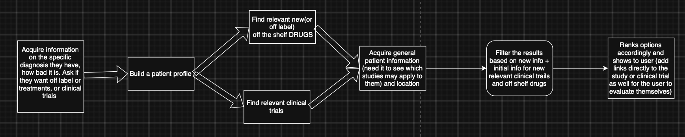

# CuraFind

This is a project for HackMidwest 2026: finding clinical trials and off label drug therapies for rare conditions. Given a patient with a diagnosis, they may be interested in more options such a clinical trial or a very new drug. However, these are very hard to find with thousands of clinical trials currently going on and papers constantly being published. CuraFind is a tool to help find *relevant* trials that one could qualify for as well as find new drugs that could possibly work.

None of the claims made by this are to be taken as fact or replace the advice of a medical professional. It *is* supposed to help the search to get better though. People that are willing to do a clinical trial or try a new treatment shouldn't need to go through the daunting effort of finding a compatible one.

## Tech Stack/Architecture

### Application stack

| Layer | Implementation |
| --- | --- |
| Frontend | Next.js 16 App Router, React 19, and TypeScript; Tailwind CSS 4 with shadcn/Base UI components and Lucide icons. |
| Backend | Next.js Route Handlers for trial search and eligibility/ranking, plus a Server Action for the homepage's drug-research flow. External API requests and model calls run on the server. |
| Research sources | ClinicalTrials.gov v2 for trial records; PubMed E-utilities for research articles; EBI's Ontology Lookup Service with MONDO for disease names and synonyms. |
| AI execution | Local Ollama decisions for trial/study scoring and eligibility; AWS Strands Agents TypeScript SDK for question generation and clinical-trial ranking. Zod validates both result formats. |
| Article parsing | `fast-xml-parser` extracts abstracts and chemical metadata from PubMed XML. |

The browser starts the selected trial and drug searches concurrently. It waits
for both to settle, preserving successful results if the other search fails.
Search results and eligibility answers are held in React state; the current
flow has no database-backed patient profile or saved-search storage.

### How we use AWS Strands

The question and ranking evaluators in `src/lib/evaltools.ts` create a fresh
Strands `Agent`, supplying a model adapter, a task-specific `systemPrompt`, and a
Zod `structuredOutputSchema`. Trial scoring, study scoring, and eligibility use
the separate local adapter in `src/lib/local-decision-model.ts`. The application calls `agent.invoke()` with the
condition and relevant research data, then validates `result.structuredOutput`
before using it. Separate agents keep prior evaluations out of the next task's
conversation history.

CuraFind supports five evaluation steps:

| Function | Structured result used by the application |
| --- | --- |
| `evaluateTrial` | A local applicability decision score for a trial and condition. |
| `criterionFinder` | Patient-facing eligibility questions with number, yes/no, or text answer types; the application assigns question IDs. |
| `evaluateEligibility` | A local potential-eligibility decision for one trial, based on its criteria and the patient's answers. Missing or uncertain information does not by itself exclude a trial. |
| `rankTrials` | An ordered list of trial IDs, explanations, and extracted treatment names. The application checks that every supplied trial appears exactly once and reattaches its original metadata. |
| `evaluateStudy` | Local applicability and estimated efficacy scores from an article abstract. |

Trial ranking rotates through Groq, optional Cerebras, and Google model adapters.
Question generation uses Google. The three local evaluators default to Ollama
`tev1:4b` through `/v1/systemone`; see [configuration and API details](./docs/evaluation-api.md).

Strands provides the agent invocation and structured-output interface; the
TypeScript application controls retrieval, batching, selection, and the order
of evaluation steps. Research APIs are called directly by application code,
rather than exposed as agent tools. The remaining cloud provider configuration calls
Groq, Cerebras, and Google directly.

## How to Use/Run

- Clone the repo down
- Setup API keys with providers based on `.example.env`.
- `cd` into the repo and run `npm install` to install dependencies
- Run `npm run build` to build for production
- Run `npm run start` to start the production build
- Navigate to [localhost:3000](http://localhost:3000) to start using CuraFind

## Tests

Run `npm test` for the full suite or `npm run test:eval` for evaluator, evaluation
endpoint, and trial workflow tests. Tests mock retrieval and model services and
need no API keys or development server. See [testing details](./docs/testing.md)
for coverage and guidance when changing the evaluation backend.
